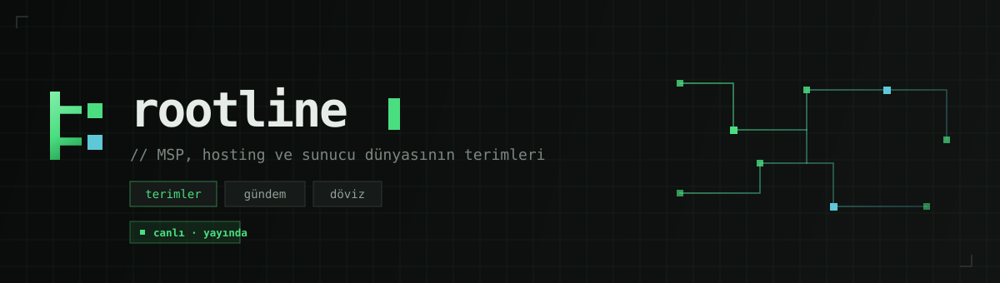
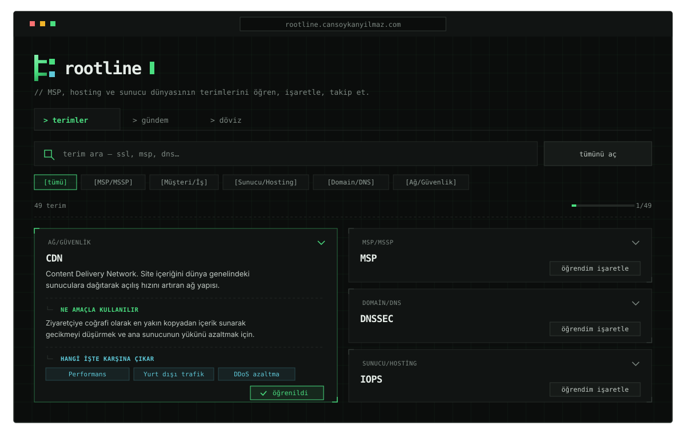
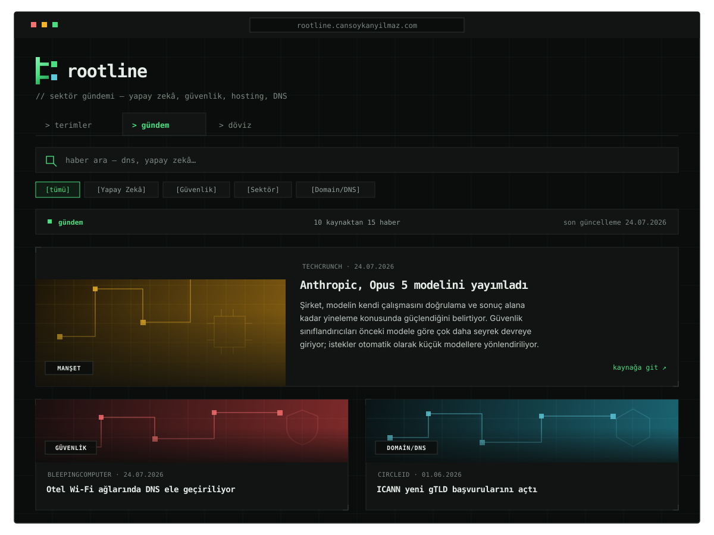

  
  
  
  

  <a href="https://rootline.cansoykanyilmaz.com"><b>rootline.cansoykanyilmaz.com &nbsp;→</b></a>

  <a href="README.md">Türkçe</a> · <b>English</b>

 

## What is it?

**rootline** is a Turkish-language reference application that teaches the
terminology of MSP/MSSP, hosting, domain/DNS, and network security work,
follows industry news, and collects the small tools you need day to day in one
place.

> **A note for English-speaking visitors:** the application itself is in
> Turkish, deliberately. This field's vocabulary is overwhelmingly English, and
> people working in it in Türkiye learn the terms by absorbing them rather than
> understanding them. rootline exists to close that gap — an English version
> would be solving a problem that does not exist.

For someone working in this field, terminology, current news, and exchange-rate
tracking are scattered across separate sources. rootline brings them together
in one plain, fast, ad-free interface — no installation, no account, no clutter.

 

## What's inside?

| | |
| :-- | :-- |
| **`terimler`** (terms) | 49 industry terms. Each is explained in four layers: *what it is* → *what it is used for* → *where you'll run into it* → *a concrete example*. Search, category filters, and a "learned" marker for tracking your own progress. |
| **`gündem`** (news) | Current news from AI, security, hosting, and DNS. Scanned twice a day from 27 verified sources; each item is published with an original Turkish summary and a link to the source. One tap takes you to the related term. |
| **`döviz`** (currency) | Hosting and domain costs are denominated in foreign currency. USD/EUR/GBP → TRY converter, historical rate chart, and rate alerts. |

 

## Screenshots

 

 

## Usage

Opens in a browser. No download, installation, or sign-up:

  <a href="https://rootline.cansoykanyilmaz.com"><b>rootline.cansoykanyilmaz.com</b></a>

Your "learned" marks are stored only in your own browser; no account is created
and nothing is recorded server-side.

 

## Design and engineering approach

rootline treats simplicity and privacy as principles:

- **Single file, zero dependencies.** The interface depends on no external
  library — no charting library, no framework, no icon pack. Everything,
  including the charts, icons, and flags, is hand-made.
- **Its own icon set.** 30 icons drawn from scratch for rootline: 24×24 grid,
  square caps, angular joins — a schematic/plotter vocabulary.
- **Self-hosted fonts.** No connections to third parties such as Google Fonts;
  no visitor data leaves the site.
- **No outbound requests.** The single exception is the open reference API used
  for exchange rates, and that is stated plainly in the interface.
- **Honest data.** Rates are labelled "ECB daily reference rate"; misleading
  phrasing such as "real time" or "bank rate" is not used.
- **Respect for copyright.** News summaries are not copied from the source;
  they are written in our own words, and every entry links to the original.
- **Accessibility.** Full keyboard navigation, screen-reader support, WCAG AA
  contrast targets, and `prefers-reduced-motion` support.

 

## Source code

This repository is for **presentation and usage information only**; it does not
contain the application's source code. The source is private and not public.

 

## Licence

Copyright © 2026 Can Soykan Yılmaz. All rights reserved.

rootline is free to use in your browser, and you may use the term explanations
in your own learning or when training your team, with attribution. Bulk copying
of the content, use of the brand, and scraping for AI training require
permission. Details: [LICENSE](LICENSE).

 

---

  A <a href="https://cansoykanyilmaz.com">cansoykanyilmaz.com</a> project · © 2026

